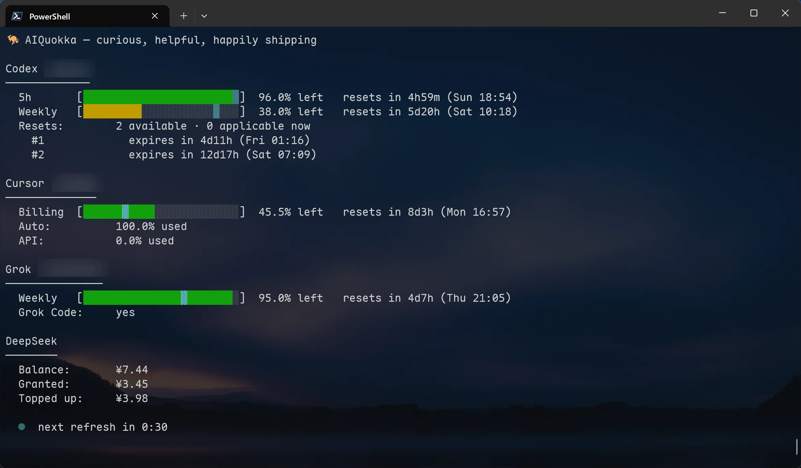

# aiquokka

**English** | [简体中文](README.zh-CN.md)

Check remaining quotas, reset times, and API account balances for your AI coding assistants in one terminal view.

This is a fork of [McKean/aiquokka](https://github.com/McKean/aiquokka), maintained by [iugamlabs](https://github.com/iugamlabs/aiquokka). It reuses credentials from official CLIs and clients, and supports API keys supplied through environment variables.



## Fork highlights

- **Cursor support**: discover credentials from Cursor Agent, the OS credential store, and Cursor Desktop to check billing-cycle usage. Percentages come from the provider; missing percentages remain unknown rather than being inferred from spending.
- **Clear remaining quotas**: bars and `left` percentages both show remaining quota, with green / yellow / red colors and a cyan pace marker. Bars align across providers in the aggregate view.
- **Automatic credential recovery**: the default `auto` policy silently refreshes expired credentials and safely persists them where supported, with a `readonly` option available. Single-provider interactive queries can invoke the official Codex / Grok login command when reauthentication is needed and conditions allow it.
- **Codex reset credit details**: distinguish available credits from credits applicable now, and show expiration times. The terminal lists up to three expiration entries; JSON / YAML retain the full returned details.
- **Account balances**: DeepSeek shows total, granted, and topped-up balances directly, without a progress bar. OpenRouter support adds balance, total credits, and spending queries.
- **Muse and desktop tray**: check Muse subscription quotas, or use the optional macOS / Linux tray build to view remaining quotas and receive alerts. The default CLI retains pure Go builds across platforms.
- **Shared provider registry**: subcommands, aggregate queries, and `--list` use the same provider catalog for easier extension and maintenance.
- **Cross-platform distribution**: Windows, macOS, and Linux builds for amd64 / arm64, with Homebrew, Scoop, and Go installation options.

The fork also retains concurrent provider queries, watch mode, and JSON / YAML output. Aggregate queries skip unconfigured services and keep displaying results when one service fails. In an interactive terminal, providers appear in a fixed order and update as responses arrive. Non-interactive aggregate queries wait about 15 seconds, retaining completed results and reporting errors for services that have not responded.

## Installation

### Homebrew

```sh
brew tap iugamlabs/tap
brew install aiquokka
```

### Scoop

```powershell
scoop bucket add iugamlabs https://github.com/iugamlabs/scoop
scoop install aiquokka
```

### Go

Requires Go 1.26.5 or later; see [go.mod](go.mod) for the version requirement.

```sh
go install github.com/iugamlabs/aiquokka@latest
```

You can also download a binary for your platform from [Releases](https://github.com/iugamlabs/aiquokka/releases), or build from the source directory:

```sh
go build -o aiquokka .
```

## Usage

Sign in through the official CLI / client, or configure the environment variable listed below for services that use API keys, then run:

```sh
aiquokka                  # All configured services
aiquokka --list           # List supported providers; also available as aiquokka list
aiquokka codex            # Codex only
aiquokka cursor           # Cursor only
aiquokka muse             # Muse only
aiquokka --watch          # Refresh all services every 60 seconds
aiquokka codex -w         # Watch a single service
aiquokka --version        # Show version
aiquokka --help           # Show help
```

In watch mode, an interactive terminal shows a countdown to the next refresh. Press `r` to refresh immediately, or `q` / Ctrl+C to exit.

### Supported services and credentials

| Command | Reports | Credential source |
| --- | --- | --- |
| `claude` | 5-hour, weekly, and Weekly Fable quotas | `$CLAUDE_CONFIG_DIR/.credentials.json` (default: `~/.claude/.credentials.json`), or macOS Keychain |
| `codex` | 5-hour / weekly quotas, reset credits, and expiration details | `~/.codex/auth.json` |
| `cursor` | Billing-cycle quota, Auto / API usage percentages, and on-demand spending | Cursor Agent auth file, OS credential store, or Desktop `state.vscdb` |
| `kimi` | Kimi Code 5-hour and weekly quotas | OAuth credentials in `~/.kimi-code` / `~/.kimi`, or `KIMI_API_KEY` |
| `grok` | Period quota, subscription tier, and Grok Code status | `~/.grok/auth.json` |
| `copilot` | Premium, Chat, and Completions quotas | `apps.json` / `hosts.json` in the GitHub Copilot configuration directory |
| `deepseek` | Total, granted, and topped-up balances | `DEEPSEEK_API_KEY` |
| `kiro` | Monthly credits, plan, reset date, and overage status | Invokes the installed `kiro-cli /usage`; the official CLI manages credentials |
| `antigravity` (alias `agy`) | Antigravity quotas | Invokes the authenticated official CLI with `agy -p /usage --output-format json` |
| `zai` | Prepaid resource packages and cash balance | `ZAI_API_KEY`, or the zai configuration in `~/.pi/agent/models.json` |
| `openrouter` | Account balance, total credits, and spending | `OPENROUTER_MANAGEMENT_KEY` |
| `muse` | 5-hour and weekly subscription quotas | `MUSE_AUTH_PATH` or `$XDG_CONFIG_HOME/muse/auth.json` (default: `~/.config/muse/auth.json`); invokes `muse serve` if no inline token is available |

Services display only data returned by their APIs. Windows and fields depend on the account and plan. Selecting an unconfigured provider directly displays a configuration hint.

Example API key setup (sh / bash / zsh):

```sh
export DEEPSEEK_API_KEY="your DeepSeek API key"
export OPENROUTER_MANAGEMENT_KEY="your OpenRouter Management API key"
aiquokka
```

OpenRouter requires a **Management API key**; regular inference API keys cannot query account credits. The balance is calculated as `total_credits - total_usage` from the API response and displayed in USD.

For the Z.ai China platform, set `ZAI_BASE_URL=https://open.bigmodel.cn/api`; balances are then displayed in CNY. Resource packages are listed by their applicable models; check the `Applies to` field.

### Reading quotas

- Solid `█` cells show remaining quota; gray `░` cells show consumed quota. `left` is the remaining percentage.
- Remaining quota above 40% is green, 15%–40% is yellow, and below 15% is red.
- The cyan marker shows how much quota would remain with even consumption over the current window. A remaining bar beyond the marker means slower consumption; a shorter bar means faster consumption. The marker appears only when window timing is known.
- Reset times include both a relative countdown and local time.
- DeepSeek and OpenRouter display monetary amounts directly, without inferring a remaining percentage.

When Cursor provides a quota percentage, provider messages that may conflict with that quota are hidden by default. Enable debug information when troubleshooting:

```sh
AIQUOKKA_DEBUG=1 aiquokka cursor
```

### JSON / YAML output

```sh
aiquokka --json
aiquokka codex --yaml
aiquokka cursor --yml       # Alias for --yaml
aiquokka --watch --json     # Emit a new JSON document on each refresh
```

Aggregate output uses lowercase provider names as keys. Unconfigured services are omitted; failed queries include an `error` field. JSON and YAML output flags are mutually exclusive.

In structured output, `used_percent` still means the **consumed percentage**, unlike `left` in the terminal. Watch mode emits multiple documents in sequence, so scripts must process each document separately.

Windows include a stable `id`, known durations use `duration_seconds`, and model-specific quotas may include `model`. When the duration and reset time are known, `target_percent` grows linearly from 10 at the start to 90 at the end (`10 + 80 × Pace`), providing a buffered consumption target. This differs from the terminal's unadjusted linear pace marker. Missing information is not inferred: unknown `resets_at` is omitted, and an empty `windows` list is `[]`.

When the signed-in account can be identified, `account` contains only the available `id` / `email`, never tokens. Full Codex `reset_credits` details are retained. Exit codes are `0` for success, `3` when a selected service is unconfigured or signed out, and `1` for other failures. Aggregate queries continue to represent individual provider failures through their `error` fields.

## Credential policies and authentication recovery

The default policy is `auto`: valid credentials are read directly; expired credentials use the recovery mechanism supported by the provider. Claude, Codex, Cursor, Grok, and Kimi support refreshing and persisting credentials. Refresh tokens may rotate, so updated credentials must be safely saved to avoid losing the new token.

```sh
aiquokka codex                              # Default: auto
aiquokka --credential-policy readonly       # Do not refresh or persist credentials
aiquokka --no-refresh                       # Compatibility shortcut for readonly
aiquokka --credential-policy persist codex   # Explicitly select refresh and persist
```

| Policy | Behavior |
| --- | --- |
| `auto` | Default; select safe recovery based on provider capabilities, or ask for official CLI sign-in if recovery fails |
| `readonly` | aiquokka does not refresh or persist credentials; Kiro, Antigravity, and Muse CLI queries still let official clients manage their own credentials |
| `memory` | Refresh only in memory without saving; currently unsupported by all providers and returns an error |
| `persist` | Refresh and safely persist credentials when needed; currently supported only by Claude, Codex, Cursor, Grok, and Kimi |

The policy applies to all providers in the invocation and does not switch accounts. Unsupported policies return an explicit error. `--no-refresh` can be combined with explicit `readonly`, but conflicts with explicit `auto` / `memory` / `persist`.

Muse queries using file-based login are cached in the process for five minutes. If no active window is reported, usage is shown as unknown with a hint. The CLI waits up to 15 seconds by default; adjust this with `AIQUOKKA_MUSE_CLI_TIMEOUT=30s`, though a shorter caller timeout still takes precedence. On macOS, if CLI login succeeds but returns no usage, run `muse logout`, then `TBH_CREDENTIAL_BACKEND=file muse login`, and keep that environment variable set when using Muse afterward.

After successful silent refresh for Codex / Grok, the original query is retried at most once. If reauthentication is required, `codex login` or `grok login` may run automatically only for a **single-provider query with interactive input and output, outside watch mode, JSON / YAML output, and CI**. A successful login is followed by another query. Aggregate queries and scripts display a sign-in hint.

On macOS, Claude first reads a credentials file containing an OAuth access token, then falls back to Keychain through the system `security` tool. When using SSH, unlock a locked keychain first with `security unlock-keychain` if needed.

## Optional desktop tray

The default CLI includes a `tray` command with setup guidance. Build the full tray version separately for macOS / Linux; it also retains normal CLI subcommands. Tray percentages and quota bars show remaining quota (`left`), while alert thresholds use the **consumed percentage**, defaulting to 80%.

```sh
# Linux
CGO_ENABLED=0 go build -tags tray -o aiquokka-tray .
# macOS: requires Xcode Command Line Tools
CGO_ENABLED=1 go build -tags tray -o aiquokka-tray .

./aiquokka-tray tray                  # Refresh every minute; monitor all services by default
./aiquokka-tray tray -p agy           # Accepts provider IDs / aliases from the registry
./aiquokka-tray tray --pin claude     # Pin Claude in the top bar; keep all services in the menu
./aiquokka-tray tray --interval 2m --threshold 90
./aiquokka-tray tray --no-refresh
```

`bar`, `menu`, and `systray` are aliases for `tray`. Settings are saved to `aiquokka/tray.json` in the system user configuration directory; explicit flags take precedence. macOS provides a native preferences window, while Linux provides submenus. The refresh interval must be at least one minute. Tray mode does not support `--watch` or JSON / YAML output.

Run `scripts/build-tray.sh` to create a standalone archive containing licenses. The release workflow generates `aiquokka-tray-{linux,macos}-{amd64,arm64}.tar.gz` and `TRAY_SHA256SUMS`. The default CLI continues to provide six pure Go builds across Windows, macOS, and Linux.

## Caveats

Some queries depend on undocumented endpoints used by official clients or on local credential formats, which may change as services update. Use the built-in 60-second watch interval and avoid running multiple watchers or polling frequently, which can trigger rate limits.

## Attribution and license

Thanks to [McKean/aiquokka](https://github.com/McKean/aiquokka) for the original implementation. This fork continues to improve provider support, quota display, and credential recovery.

For maintenance and future upstream synchronization, see the [fork merge guide](docs/fork-merge-guide.md) (Chinese).

The project uses the [MIT License](LICENSE). For licenses covering the tray's bundled systray library and icons, see the [third-party notices](third_party/NOTICE.md).
